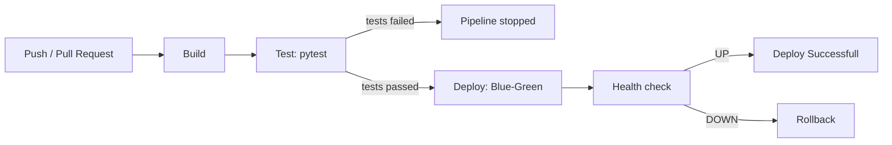
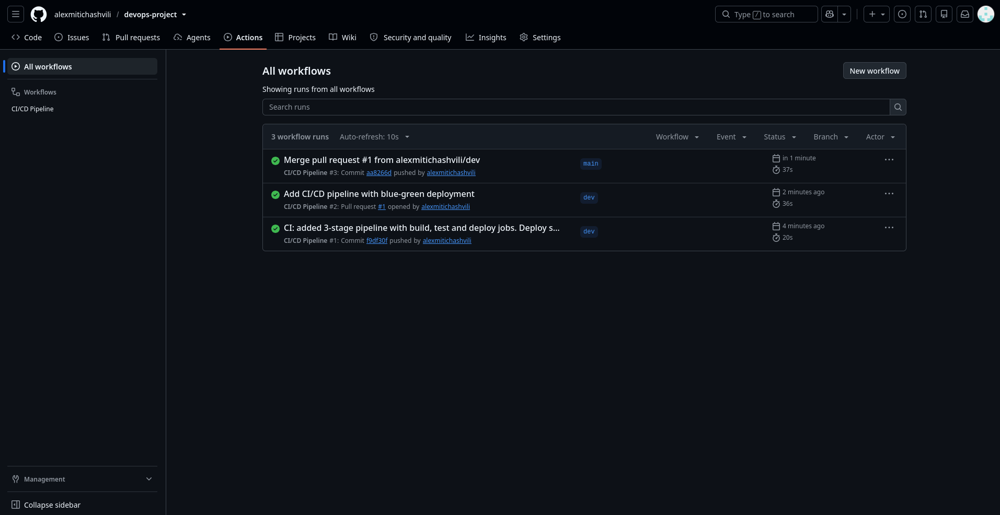
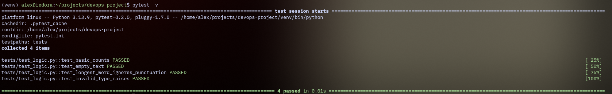
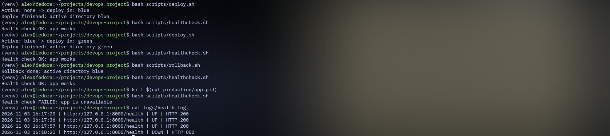
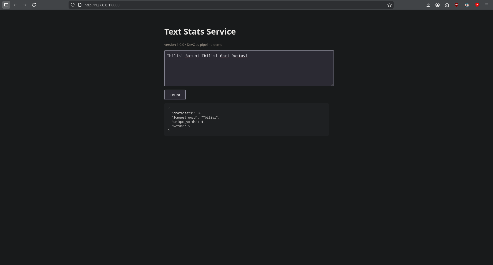

# DevOps Project - Text Stats Service

## Description of the project
Small web-service written with Flask, that counts stats according to provided text:
characters count, words count, unqiue words count and the longes word.

Stack: Python 3.11, Flask, pytest, Git/GitHub, GitHub, GitHyb Actions, Bash, curl.

Endpoints:
- `/` - web-interface
- `/health` - state check 
- `/api/stats?text=...` - JSON with stats

## Branches
- `dev` - development, here go all changes
- `main` - stable version, changes get there via Pull Request

## CI/CD process
Pipeline described in `.github/workflows/ci-cd.yml` and starts automatically on each push in `main`/`dev` and on each Pull Request in `main`.

**1. Build** - setting up the environment: installing Python 3.11 and dependencies from `requirements.txt`, checking code syntax.

**2. Test** - start of unit-tests (`pytest -v`). If at least one test failed, pipeline stops and deploy wont complete. 

**3. Deploy** - executes only on push in `main`. Script `scrips/deploy.sh` uses **Blue-Green** strategy: new version is copied in inactive directory(`production/blue` or `production/green`), old 
version stops, new starts. Then `scripts/healthcheck.sh` checks `/health`. If check did not pass, `scripts/rollback.sh` automatiically starts and returns previous version.

> Github Actions each time starts clean machine, that's why in CI deploy
> always goes in `blue`. Switch blue <-> green and rollback
> shown locally (check `logs/health.log`).

## Monitoring
`scripts/healthcheck.sh` sends `curl` request to `/health` and writes the result in `logs`health.log`.

## Workflow diagram




## Screenshots

### Successfull three step pipeline

All three jobs --- Build, Test and Deploy finished successfully.

### Successfull unit-test launch

Four tests from `tests/test_logic.py` passed with no errors.

### Bash script successfull workflow

The deployment, health check and rollback successfull. 

### Working app

App launched locally on `http://127.0.0.1:8000`.

## Local launch
```bash
python -m venv venv && source venv/bin/activate
pip install -r requirements.txt
pytest -v
bash scripts/deploy.sh
bash scripts/healthcheck.sh
```
